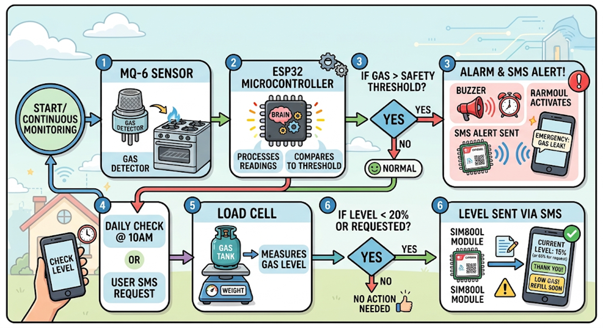
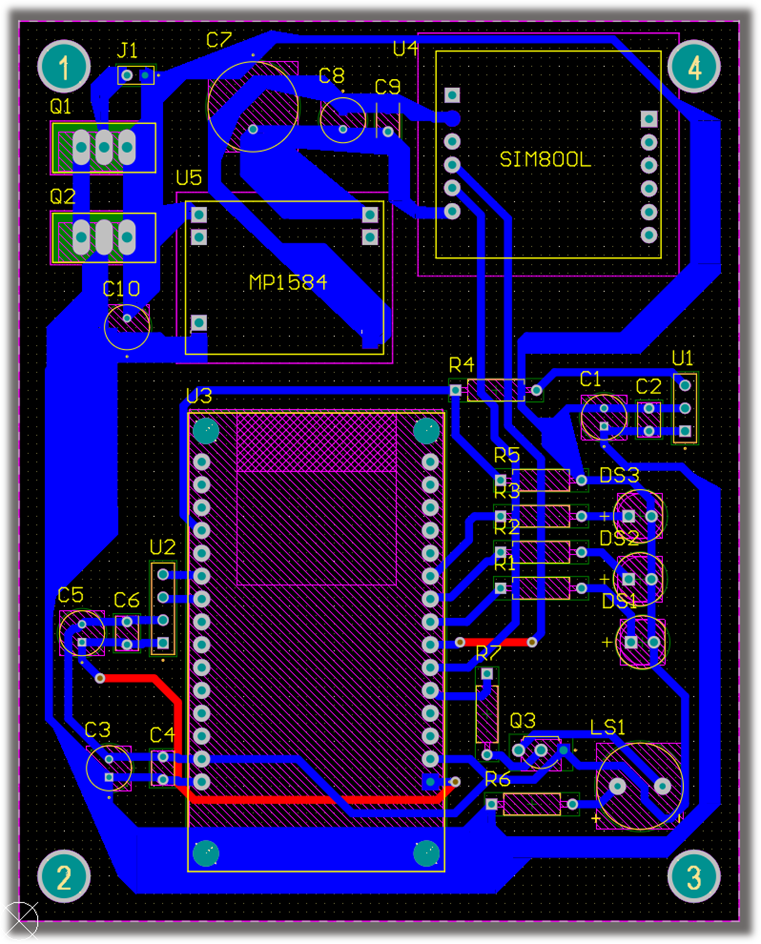
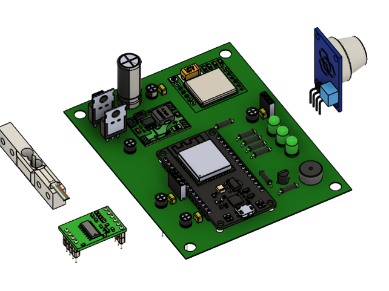

# 🔥 GasGuard – Smart LPG Safety & Monitoring System



## 🚨 Overview

**GasGuard** is an IoT-based LPG safety and monitoring system designed to improve household gas safety by combining **gas leak detection, real-time gas level monitoring, and remote user alerts** into a single compact device.

The system continuously monitors LPG leakage using a gas sensor and estimates the remaining gas level using a load cell-based measurement system. In case of a gas leak or low gas level, users are notified instantly through SMS using GSM communication.

The project focuses on developing a practical consumer safety product by integrating **embedded systems, sensor interfacing, PCB design, power management, and wireless communication**.

---

# ✨ Features

## 🔥 LPG Leak Detection
- Continuously monitors LPG concentration using an MQ-6 gas sensor.
- Activates local alerts using:
  - Buzzer alarm
  - Warning LED
- Sends SMS alerts during dangerous gas leakage conditions.

---

## ⚖️ Smart Gas Level Monitoring

- Measures LPG cylinder weight using:
  - Load cell
  - HX711 load cell amplifier
- Calculates the remaining gas percentage.
- Automatically checks gas level periodically.
- Allows users to request the current gas level through SMS.

---

## 📱 Remote SMS Monitoring

Users can interact with GasGuard using SMS commands.

Example:

```
User:
LEVEL

GasGuard:
Current gas level: 65%
```

The system sends alerts for:

✅ Low gas level  
✅ Gas leakage detected  
✅ User-requested gas status

---

# 🛠️ Hardware Components

| Component | Purpose |
|-----------|---------|
| ESP32 | Main microcontroller |
| MQ-6 Gas Sensor | LPG leak detection |
| Load Cell | Gas cylinder weight measurement |
| HX711 | Load cell signal amplification |
| SIM800L GSM Module | SMS communication |
| Buzzer | Audible warning |
| LEDs | Visual indicators |

---

# 🔌 PCB Design

## Custom PCB Development

The custom PCB was designed using **Altium Designer** with focus on:

- Power distribution
- GSM module power requirements
- Sensor interfacing
- Noise reduction
- Reliable embedded operation

### PCB Features

- Two-layer PCB design
- Dedicated power routing
- Decoupling capacitors for stable operation
- Optimized routing for GSM current bursts

---

# ⚡ Power Management

GasGuard uses a battery-powered architecture designed to support GSM transmission requirements.

Features:

- ⚡ Buck converter for voltage regulation
- 💾 Low-power operation strategies
- 📶 GSM sleep mode optimization

---

# 💻 Software Implementation

## Embedded Firmware

Developed firmware using **Embedded C/C++**.

Main functions include:

- Reading MQ-6 sensor values
- Processing load cell measurements
- Calculating gas percentage
- Handling SMS commands
- Controlling alerts
- Managing GSM communication

---

# 📡 Communication

## GSM Communication

SIM800L communicates with ESP32 using:

- UART protocol
- AT commands

Implemented features:

- Sending SMS alerts
- Receiving SMS commands
- Parsing user requests

---

# 🧪 Calibration & Testing

## Load Cell Calibration

Calibration process involved:

1. Reading raw HX711 values
2. Applying known weights
3. Calculating calibration factor
4. Converting readings into gas percentage

## Sensor Testing

Tested:

- Gas leak detection response
- SMS alert reliability
- Weight measurement accuracy
- Power stability during GSM transmission

---

# 📷 Project Images

<!--## Prototype-->

<!---->

## PCB Design



## PCB 3D View



---

# 🚀 Future Improvements

- AI-based gas consumption prediction
- Mobile application integration
- Cloud-based monitoring dashboard
- Automatic gas shutoff valve integration
- Advanced low-power optimization

---

# 🧰 Technologies Used

### Hardware
- ESP32
- MQ-6 Gas Sensor
- HX711
- Load Cell
- SIM800L GSM Module

### Software
- Arduino IDE
- Embedded C/C++
- AT Commands

### PCB Design
- Altium Designer

